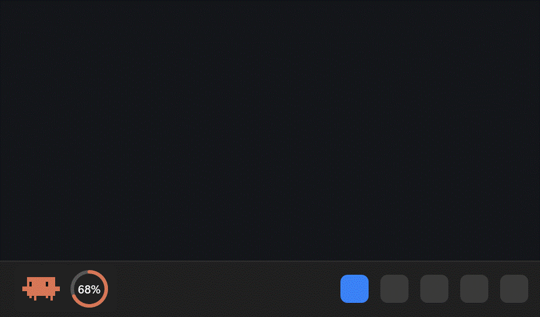
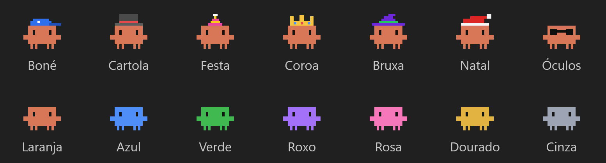
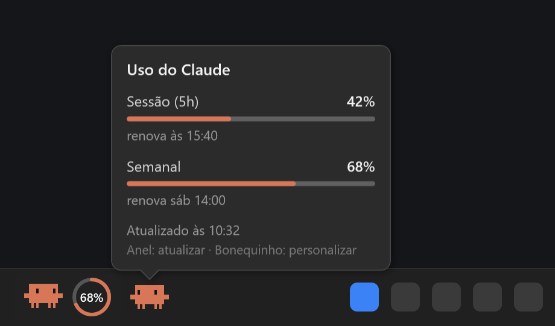

# Claude Widget

O mascote do **Claude Code** morando na sua barra de tarefas do Windows, com um anel que mostra quanto do seu plano do Claude você já usou.



Sem instalar nada além do que já vem no Windows: é um script de PowerShell com WPF.

## O que ele faz

- **Mostra o uso do plano** num anel ao lado do mascote: o maior entre o limite da sessão (5 horas) e o semanal. O anel fica laranja, amarelo a partir de 75% e vermelho a partir de 90%.
- **Passando o mouse**, um segundo mascote chega andando e traz um balão com a sessão e a semana, cada uma com a hora em que renova.
- **Se mexe o tempo todo:** anda, respira, olha em volta, pula, dança e pisca. Dá para desligar.
- **Clique no anel** para atualizar na hora. Sozinho, ele atualiza a cada 5 minutos.
- **Clique no mascote** (ou botão direito) para personalizar: cor, chapéu, óculos escuros, posição, movimento e o visitante.
- **Funciona com vários monitores:** uma cópia em cada barra de tarefas. Some no monitor que estiver em tela cheia (vídeo, apresentação, jogo) e quando a barra se esconde.



## Posição: cada um tem a barra de um jeito

Barra centralizada, alinhada à esquerda, com o botão de Widgets, com muitos apps abertos... por isso a posição é ajustável, e por monitor:

| Opção | O que faz |
| --- | --- |
| **Automático** (padrão) | Lê a barra (UI Automation) e acha um espaço livre: o canto esquerdo se estiver vazio, logo depois do botão de Widgets se ele existir, ou encostado na bandeja se o Iniciar estiver no canto esquerdo. Reavalia a cada 30 segundos. |
| **Canto esquerdo** | Sempre no canto esquerdo. |
| **Perto do relógio** | Encostado à esquerda da bandeja do sistema. |
| **Arrastar** | Segure o widget e arraste para qualquer ponto da barra. A posição fica salva para aquele monitor. |



## Instalação

Precisa de:

- Windows 10 ou 11.
- O [Claude Code](https://claude.com/claude-code) instalado e logado com sua conta do Claude (Pro, Max, Team ou Enterprise). O widget usa esse login para ler o uso do plano. Quem usa só chave de API não tem limite de plano para mostrar.

Baixe o projeto (botão **Code > Download ZIP**, ou `git clone`) e rode, na pasta dele:

```powershell
powershell -ExecutionPolicy Bypass -File .\instalar.ps1
```

Ele copia o widget para `%LOCALAPPDATA%\ClaudeWidget`, cria os atalhos **Claude Widget** na Área de Trabalho e no menu Iniciar e já abre o widget. Não precisa de administrador.

Para abrir junto com o Windows:

```powershell
powershell -ExecutionPolicy Bypass -File .\instalar.ps1 -ComWindows
```

> Em computador de empresa, o antivírus pode bloquear programas que abrem sozinhos com o Windows. Nesse caso, use o atalho da Área de Trabalho ou peça à TI para liberar.

Para atualizar, baixe a versão nova e rode o `instalar.ps1` de novo: suas escolhas (cor, chapéu, posição) continuam.

## Como usar

| Ação | O que acontece |
| --- | --- |
| Passar o mouse | O visitante chega com o balão de uso |
| Clicar no anel | Atualiza o número na hora |
| Clicar no mascote ou botão direito | Abre o menu: cor, chapéu, óculos, posição, movimento, visitante, fechar |
| Segurar e arrastar | Muda o widget de lugar na barra |

Opções para quem quiser rodar o script direto:

```powershell
powershell -NoProfile -STA -WindowStyle Hidden -File claude-widget.ps1 -IntervaloMinutos 5 -Mostrar maior
```

- `-IntervaloMinutos`: de quanto em quanto tempo busca o uso (padrão 5).
- `-Mostrar maior|sessao|semanal`: qual limite o anel mostra (padrão: o maior dos dois).
- `-Margem`: distância das bordas, em pixels (padrão 12).
- `-Previa <pasta>`: gera as imagens deste README sem abrir o widget.

## Privacidade e como funciona

- O widget lê o token de login que o Claude Code guarda em `%USERPROFILE%\.claude\.credentials.json` e consulta o uso em `api.anthropic.com/api/oauth/usage`, o mesmo endereço que o Claude Code usa para mostrar o uso. Não fala com nenhum outro servidor.
- Ele **não renova nem grava** o login. Se o token vencer, aparece um `?`. Basta abrir o Claude Code, que renova o login, e o widget volta sozinho.
- O Windows não deixa programas entrarem de verdade na barra de tarefas. Por isso, o widget é uma janelinha transparente "sempre visível" colada em cima dela.
- O desenho é feito pela CPU de propósito: são janelas minúsculas, e pela placa de vídeo o driver reservava centenas de MB à toa. Fica em torno de 120 MB de memória e 1 a 2% de um núcleo.

## Limitações

- O endereço de uso não é uma API documentada publicamente. Se a Anthropic mudar algo, o widget pode parar de mostrar o número até ser atualizado.
- Feito e testado no Windows 11 com barra na parte de baixo da tela.

## Desinstalar

```powershell
powershell -ExecutionPolicy Bypass -File .\desinstalar.ps1
```

Fecha o widget, apaga os atalhos e a pasta `%LOCALAPPDATA%\ClaudeWidget`.

## Aviso

Projeto pessoal, feito por fã, **sem ligação com a Anthropic**. Claude e Claude Code são marcas da Anthropic. O mascote é redesenhado em pixel art a partir da tela de boas-vindas do Claude Code.

## Licença

[MIT](LICENSE)
