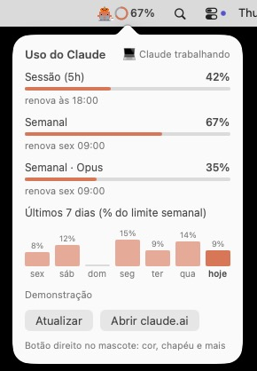

# Claude Widget

O mascote do **Claude Code** morando na sua barra de tarefas do Windows (e agora na barra de menus do Mac), com um anel que mostra quanto do seu plano do Claude você já usou.


| Windows 10 e 11 | Mac (beta) |
| --- | --- |
| **[⬇️ Baixar o ClaudeWidget.exe](https://github.com/dev-lucccaslp/claude-widget/releases/latest/download/ClaudeWidget.exe)** | **[⬇️ Baixar o ClaudeWidget-mac.zip](https://github.com/dev-lucccaslp/claude-widget/releases/latest/download/ClaudeWidget-mac.zip)** |
| Um arquivo só, de 150 KB, sem instalar nada. [Como instalar](#windows) | macOS 11 ou mais novo, chip M ou Intel. [Como instalar](#mac-beta) |

Todas as versões ficam na [página de Releases](https://github.com/dev-lucccaslp/claude-widget/releases).

## O que ele faz

- **Mostra o uso do plano** num anel ao lado do mascote. Você escolhe o que o anel mostra: o maior dos dois limites, só a sessão de 5 horas ou só o semanal. O anel fica laranja, amarelo a partir de 75% e vermelho a partir de 90%.
- **Passando o mouse**, um segundo mascote chega e traz um balão com:
  - a sessão e a semana, cada uma com a hora em que renova;
  - os limites semanais por modelo e os créditos extras, quando a sua conta tiver;
  - um gráfico dos **últimos 7 dias**, com quanto do limite semanal você gastou em cada dia.
- **O visitante chega do jeito que você quiser:** a pé, de skate, bicicleta, carro, foguete, patinete, disco voador ou tapete mágico.
- **Claude codando 💻:** enquanto o Claude Code está trabalhando, o mascote senta no notebook e digita, com símbolos de código saindo do teclado. O balão avisa "Claude Code trabalhando agora".
- **Pausa para o café ☕:** depois de 15 a 25 minutos de trabalho, ele avisa "Vou buscar um café ☕ Já volto!", levanta, sai andando e volta com a xícara fumegando, que fica ao lado do notebook.
- **Reage ao seu uso:** perto de 90%, o mascote fica cansado, suando e ofegante. Quando o limite renova, ele comemora com pulos e confete.
- **Dá bom dia, boa tarde ou boa noite** quando você liga ou desbloqueia o PC, já com um resumo do uso ("Sessão em 21% e semana em 98%. Vai com calma hoje 😅").
- **Lembretes divertidos** num balãozinho em cima do mascote: tomar água, alongar e postura, descansar a vista, e os horários de almoço, café, fim do dia e o "Sextou!". Você escolhe quais e de quanto em quanto tempo. Ele não fala nada se você estiver longe do PC, em tela cheia ou olhando o uso.
- **Se mexe o tempo todo:** anda, respira, olha em volta, pula, dança e pisca. Dá para desligar.
- **Clique no anel** para atualizar na hora. Sozinho, ele atualiza a cada 5 minutos.
- **Clique no mascote** (ou botão direito) para personalizar: o que mostrar, cor, chapéu, óculos escuros, posição, movimento e o visitante.
- **Chapéu da estação:** gorro de Natal em dezembro, abóbora no Halloween, chapéu de palha na festa junina e chapéu de festa no Ano-Novo. Dá para desligar.
- **Tema claro e escuro:** o balão e o menu seguem o tema do Windows.
- **Avisa quando sai versão nova** e atualiza com um clique, pelo ícone nos ícones ocultos.
- **Fica nos ícones ocultos** da bandeja: dali você esconde ou mostra o widget, atualiza, liga o "Iniciar com o Windows" e sai.
- **Funciona com vários monitores:** uma cópia em cada barra de tarefas. Some no monitor que estiver em tela cheia (vídeo, apresentação, jogo) e quando a barra se esconde.


## Posição: cada um tem a barra de um jeito

Barra centralizada, alinhada à esquerda, com o botão de Widgets, com muitos apps abertos... por isso a posição é ajustável, e por monitor:

| Opção | O que faz |
| --- | --- |
| **Automático** (padrão) | Lê a barra (UI Automation) e acha um espaço livre: o canto esquerdo se estiver vazio, logo depois do botão de Widgets se ele existir, ou encostado na bandeja se o Iniciar estiver no canto esquerdo. Reavalia a cada 30 segundos. |
| **Canto esquerdo** | Sempre no canto esquerdo. |
| **Perto do relógio** | Encostado à esquerda da bandeja do sistema. |
| **Arrastar** | Segure o widget e arraste para qualquer ponto da barra. A posição fica salva para aquele monitor. |


## Instalação

Nos dois sistemas, precisa do [Claude Code](https://claude.com/claude-code) instalado e logado com sua conta do Claude (Pro, Max, Team ou Enterprise). O widget usa esse login para ler o uso do plano. Quem usa só chave de API não tem limite de plano para mostrar.

### Windows

Precisa do Windows 10 ou 11 (o .NET Framework que ele usa já vem no Windows).

**Jeito rápido:** baixe o `ClaudeWidget.exe` na [página de Releases](https://github.com/dev-lucccaslp/claude-widget/releases/latest) e abra. Para ele abrir junto com o Windows, use **Iniciar com o Windows** no ícone dele nos ícones ocultos.

> Na primeira vez, o Windows pode mostrar "O Windows protegeu o computador", porque o .exe não é assinado. Clique em **Mais informações > Executar assim mesmo**. O .exe é compilado pelo próprio GitHub a partir deste código ([veja o workflow](.github/workflows/release.yml)).

**Com atalhos na Área de Trabalho e no menu Iniciar:** baixe o `ClaudeWidget.zip` da mesma página, extraia e rode:

```powershell
powershell -ExecutionPolicy Bypass -File .\instalar.ps1
```

Ele põe o widget em `%LOCALAPPDATA%\ClaudeWidget`, cria os atalhos e já abre. Com `-ComWindows`, também liga o "Iniciar com o Windows". Não precisa de administrador, e rodar de novo atualiza mantendo suas escolhas.

> Em computador de empresa, o antivírus pode bloquear programas que abrem sozinhos com o Windows. Nesse caso, abra pelo atalho ou peça à TI para liberar.

**Compilar você mesmo:** clone o repositório e rode `.\build.ps1`. Ele usa o compilador C# que já vem no Windows e gera `dist\ClaudeWidget.exe`.

### Mac (beta)

Precisa do macOS 11 (Big Sur) ou mais novo, em Mac com chip M ou Intel.

1. Baixe o [`ClaudeWidget-mac.zip`](https://github.com/dev-lucccaslp/claude-widget/releases/latest/download/ClaudeWidget-mac.zip), abra para extrair e arraste o **Claude Widget** para a pasta **Aplicativos**.
2. Na primeira vez, o Mac avisa que não consegue verificar o app, porque ele não é assinado pela Apple (isso custa uma conta paga de desenvolvedor). Clique com o botão direito no app e escolha **Abrir**. No macOS 15 ou mais novo: tente abrir uma vez, depois vá em **Ajustes do Sistema > Privacidade e Segurança** e clique em **Abrir Mesmo Assim**. O app é compilado pelo próprio GitHub a partir deste código ([veja o workflow](.github/workflows/release.yml)).
3. O Mac pede para o Claude Widget usar o item **"Claude Code-credentials"** das Chaves: é ali que o Claude Code guarda o login. Digite a senha do Mac e clique em **Sempre Permitir**. Depois de trocar de versão, ele pode pedir de novo.
4. Para abrir junto com o Mac, marque **Abrir ao iniciar o Mac** no menu do mascote (macOS 13 ou mais novo; nos anteriores, use Ajustes do Sistema > Usuários e Grupos > Itens de Início).

O mascote aparece na barra de menus, em cima, ao lado do relógio:



| Ação | O que acontece |
| --- | --- |
| Clicar no mascote | Abre o painel de uso: sessão, semana, limites por modelo e o gráfico dos últimos 7 dias |
| Botão direito no mascote | Menu: mostrar %, cor, chapéu (e o da estação), óculos, movimento, Claude codando, saudação, lembretes, abrir ao iniciar o Mac, avisar de versão nova e sair |
| Clicar no balãozinho de fala | Fecha a saudação ou o lembrete |

Diferenças do Windows: na barra de menus não cabe o visitante, então o uso abre num painel; e quando sai versão nova, ele avisa e abre a página de download, sem trocar sozinho. As escolhas ficam nos ajustes do app (`defaults read io.github.dev-lucccaslp.claudewidget`). Para ver tudo o que ele faz em 15 segundos, com números de mentira: `open -a "Claude Widget" --args --demo`.

**Compilar você mesmo:** com o Xcode ou as Command Line Tools (`xcode-select --install`), clone o repositório e rode `bash mac/build.sh`. Ele gera `dist/Claude Widget.app` e o `dist/ClaudeWidget-mac.zip`. O código está em [mac/Sources/main.swift](mac/Sources/main.swift).

## Atualizar

A partir da 1.3.0, o widget olha a página de Releases uma vez a cada 12 horas. Quando sai versão nova, aparece um aviso: clique nele, ou em **Atualizar para a versão X** no ícone nos ícones ocultos. O widget baixa o `.exe` novo, confere que é ele mesmo, troca e reabre sozinho. Para fazer isso pela linha de comando, use `ClaudeWidget.exe --atualizar`.

Também dá para atualizar à mão: baixe o `.exe` novo e abra. Desde a 1.2.1, ele fecha a versão antiga sozinho e assume o lugar. Se você usou o instalador, a cópia instalada também é atualizada.

> Vindo da 1.2.0 ou de antes, faça uma vez à mão: botão direito no mascote nos ícones ocultos, **Sair**, e então abra o `.exe` novo.

No Mac, o mascote avisa quando sai versão nova e abre a página de download: baixe o zip novo e troque o app na pasta Aplicativos.

O que mudou em cada versão está em [NOVIDADES.md](NOVIDADES.md).

## Como usar no Windows

| Ação | O que acontece |
| --- | --- |
| Passar o mouse | O visitante chega com o balão de uso e o gráfico da semana |
| Clicar no anel | Atualiza o número na hora |
| Clicar no mascote ou botão direito | Abre o menu: mostrar %, cor, chapéu (e o da estação), óculos, posição, movimento, Claude codando, visitante (e como ele chega), lembretes, esconder, sair |
| Clicar no balãozinho de fala | Fecha a saudação ou o lembrete |
| Segurar e arrastar | Muda o widget de lugar na barra |
| Ícone nos ícones ocultos | Clique para esconder ou mostrar. No botão direito: atualizar o uso, mostrar %, iniciar com o Windows, avisar de versão nova, ver novidades e sair |
| Abrir o .exe de novo | Se ele estiver escondido, aparece de novo |

Linha de comando:

| Comando | O que faz |
| --- | --- |
| `ClaudeWidget.exe --atualizar` | Procura versão nova no GitHub e, se tiver, atualiza na hora |
| `ClaudeWidget.exe --sair` | Fecha o widget que estiver aberto |
| `ClaudeWidget.exe --demo` | Dá oi, comemora, mostra um lembrete, coda no notebook, vai buscar café e passa o visitante por todos os transportes (bom para gravar um vídeo) |

As escolhas ficam em `%LOCALAPPDATA%\ClaudeWidget\config.json` e o histórico do gráfico em `historico.json`, na mesma pasta. Se algo der errado, o erro fica anotado em `erros.log` e o widget continua aberto.

## Privacidade e como funciona

- O widget lê o token de login que o Claude Code guarda em `%USERPROFILE%\.claude\.credentials.json` (no Mac, no item "Claude Code-credentials" das Chaves) e consulta o uso em `api.anthropic.com/api/oauth/usage`, o mesmo endereço que o Claude Code usa para mostrar o uso.
- Para saber se o Claude Code está trabalhando, ele só repara **quando** os arquivos de conversa em `.claude/projects` mudam. Não lê o que tem dentro deles.
- Ele **não renova nem grava** o login. Se o token vencer, aparece um `?`. Basta abrir o Claude Code, que renova o login, e o widget volta sozinho.
- Para avisar de versão nova, ele consulta a página de Releases deste repositório no GitHub (`api.github.com`) a cada 12 horas. Nada seu é enviado. Para desligar, desmarque **Avisar quando sair versão nova** no ícone. Fora isso, não fala com nenhum outro servidor.
- O histórico do gráfico fica só no seu PC (`historico.json`), com os últimos 9 dias.
- O Windows não deixa programas entrarem de verdade na barra de tarefas. Por isso, o widget é uma janelinha transparente "sempre visível" colada em cima dela.
- No Windows, é um app C# com WPF, compilado para o .NET Framework 4.8. Usa em torno de 65 MB de memória e menos de 1% de CPU. No Mac, é um app Swift (AppKit e SwiftUI) de um arquivo só.

## Limitações

- O endereço de uso não é uma API documentada publicamente. Se a Anthropic mudar algo, o widget pode parar de mostrar o número até ser atualizado.
- A versão do Windows foi feita e testada no Windows 11 com barra na parte de baixo da tela.
- A versão do Mac é nova (beta). Se algo aparecer estranho, [abra uma issue](https://github.com/dev-lucccaslp/claude-widget/issues) com um print.

## Desinstalar

**Mac:** botão direito no mascote, **Sair**, e arraste o Claude Widget da pasta Aplicativos para o Lixo.

**Windows:** saia pelo ícone nos ícones ocultos e apague o `.exe`. Se usou o instalador, rode:

```powershell
powershell -ExecutionPolicy Bypass -File .\desinstalar.ps1
```

Ele fecha o widget, tira do "Iniciar com o Windows" e apaga os atalhos e a pasta `%LOCALAPPDATA%\ClaudeWidget`.

## Aviso

Projeto pessoal, feito por fã, **sem ligação com a Anthropic**. Claude e Claude Code são marcas da Anthropic. O mascote é redesenhado em pixel art a partir da tela de boas-vindas do Claude Code.

## Licença

[MIT](LICENSE)
